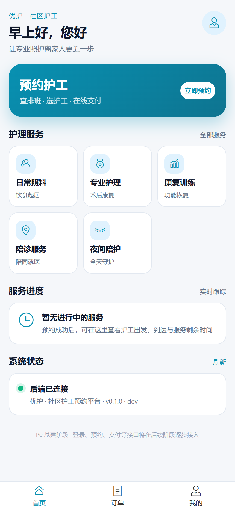
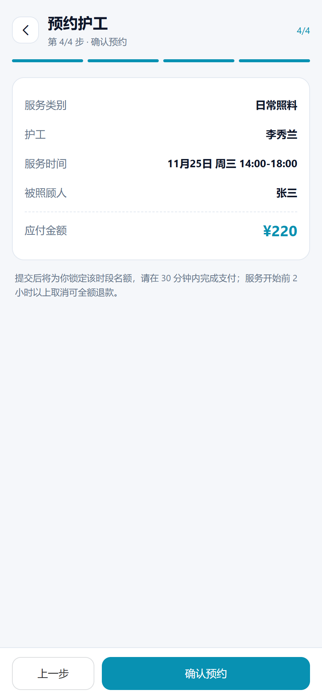
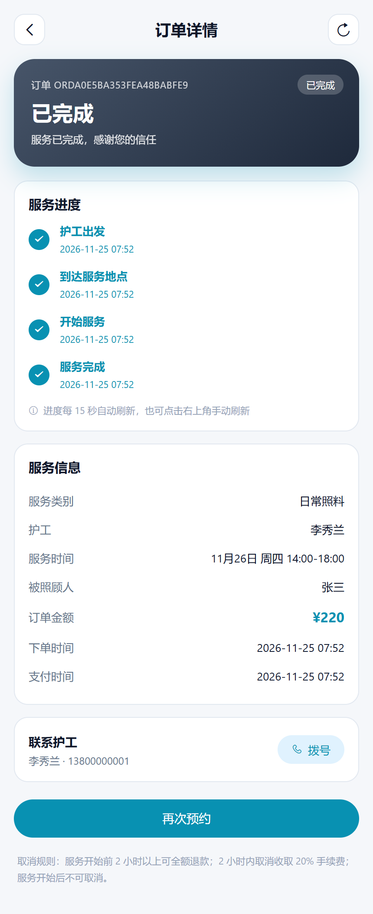
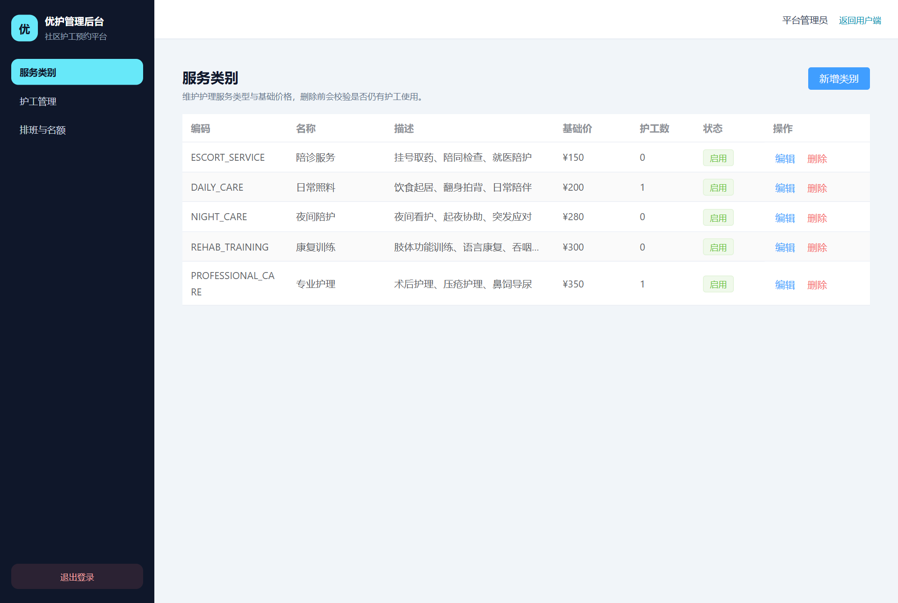
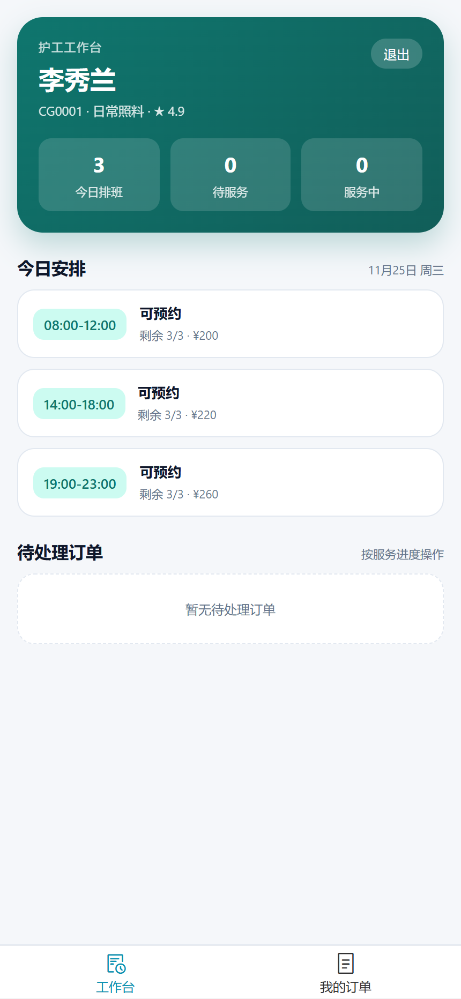

# 优护 · 社区护工预约平台

> 连接需要护工服务的家庭与专业护工：查排班、约护工、在线支付、跟踪上门服务进度。

[](https://github.com/ZhuanZ1/caregiver-platform/actions/workflows/ci.yml)
[](LICENSE)
[](https://adoptium.net/)
[](https://spring.io/projects/spring-boot)
[](https://vuejs.org/)

## 项目简介

面向社区居家养老场景的护工预约平台，覆盖三类角色：

- **用户**：手机号登录、查询护工排班、预约下单、在线支付、取消退款、跟踪服务进度、管理被照顾人
- **护工**：查看自己的排班与订单、更新出发 / 到达 / 服务完成状态
- **管理员**：维护服务类别、护工信息、排班与名额、处理停班

项目按「需求说明书 + 系统设计说明书」的功能范围实现，同时按可上线的工程标准建设：数据库版本管理、自动化测试、CI、容器化部署与完整文档。

## 界面预览

<p align="center">
  
  
  
  
</p>
<p align="center">
  
  
</p>

## 当前进度

> 正在按阶段推进：**P0–P6 已完成**（基建、数据层、认证、核心业务、三端页面、测试与质量），只剩部署发布。

| 阶段 | 内容 | 状态 |
| --- | --- | --- |
| P0 | 仓库骨架、前后端工程、统一响应、CI、基础文档 | ✅ |
| P1 | 数据库迁移（12 张表）、实体与仓库、种子数据 | ✅ |
| P2 | 认证授权：JWT、短信验证码、三角色权限、登录页联调 | ✅ |
| P3 | 核心业务：排班查询、预约、支付、取消退款、服务进度、消息 | ✅ |
| P4 | 用户端页面：预约向导、支付、订单、进度、被照顾人、消息 | ✅ |
| P5 | 护工工作台 + 管理后台（类别、护工、排班、名额、停班） | ✅ |
| P6 | 测试与质量：58 个后端测试、17 个前端测试、覆盖率门槛、OpenAPI、ESLint/Prettier | ✅ |
| P4 | 用户端完整页面 | ⬜ |
| P5 | 护工端 + 管理后台 | ⬜ |
| P6 | 测试补齐、覆盖率、E2E | ⬜ |
| P7 | Docker 部署、GitHub Actions 发布、APK 打包 | ⬜ |

详细阶段目标与验收标准见 [docs/roadmap.md](docs/roadmap.md)。

## 技术栈

| 层 | 选型 |
| --- | --- |
| 后端 | Java 17 · Spring Boot 4 · Spring Data JPA · Spring Security + JWT · Flyway · Bean Validation · springdoc |
| 数据库 | MySQL 8（开发/生产）· H2 MySQL 模式（测试） |
| 前端 | Vue 3 · TypeScript · Vite · Pinia · Vue Router · Vant 4 · Element Plus · Axios |
| 测试 | JUnit 5 · Mockito · MockMvc · H2 · JaCoCo · Vitest · @vue/test-utils |
| 工程化 | Maven · npm · ESLint · Prettier · GitHub Actions · Docker Compose（P7） |

## 目录结构

```
caregiver-platform/
├─ backend/                 Spring Boot 服务端
│  ├─ src/main/java/com/youhu/caregiver/
│  │  ├─ common/            统一响应、异常、通用工具
│  │  ├─ web/               对外接口
│  │  └─ ...
│  ├─ src/main/resources/   application*.yml、db/migration
│  └─ src/test/             单元测试 + 集成测试（H2）
├─ frontend/                Vue 3 移动端
│  ├─ src/api/              Axios 封装与接口定义
│  ├─ src/layouts/          页面布局
│  ├─ src/views/            页面
│  ├─ src/stores/           Pinia 状态
│  └─ tests/                Vitest 单元测试
├─ docs/                    架构、路线图、接口文档
├─ .github/workflows/       CI
├─ .env.example             环境变量样例
└─ docker-compose.yml       （P7）
```

## 快速开始

### 环境要求

- JDK 17+（推荐 Temurin 17）
- Maven 3.9+（仓库自带 `mvnw`，无需预装）
- Node.js 20.19+（推荐 22 LTS）
- MySQL 8.0+

### 1. 准备数据库

```sql
CREATE DATABASE caregiver_platform
  DEFAULT CHARACTER SET utf8mb4
  COLLATE utf8mb4_0900_ai_ci;
```

> 服务启动时由 Flyway 自动执行迁移脚本（V1 建表、V2 基础数据、V3 订单进度字段），无需手工导入。
> 开发环境（`dev`）首次启动且排班为空时，会自动生成未来 14 天的排班，方便直接体验预约流程。
> 如果你本地已有一个旧库，请先备份再重建，避免 Flyway 因“非空库无历史表”而拒绝启动。

### 2. 启动后端

```bash
cd backend
# 默认连接 localhost:3306，账号 root / 密码 123456
# 可用环境变量覆盖：DB_URL / DB_USERNAME / DB_PASSWORD
./mvnw spring-boot:run
```

验证：

```bash
curl http://localhost:8080/api/v1/meta
# {"code":200,"message":"操作成功","data":{"name":"caregiver-platform",...}}
```

健康检查：<http://localhost:8080/actuator/health>
接口文档（Swagger UI）：<http://localhost:8080/swagger-ui.html>
OpenAPI JSON：<http://localhost:8080/v3/api-docs>

### 3. 演示账号

| 手机号 | 角色 | 说明 |
| --- | --- | --- |
| 13800000000 | 管理员 | 平台后台 |
| 13800000001 | 护工 | 李秀兰 CG0001 |
| 13800000003 | 护工 | 王芳 CG0002 |
| 13800000002 | 普通用户 | 张三 |

> 开发环境验证码固定为 `123456`（`app.sms.fixed-code`）；生产环境请将 `SMS_FIXED_CODE` 置空并接入真实短信服务。

### 3. 启动前端

```bash
cd frontend
npm install
npm run dev
# 打开 http://localhost:5173
```

首页「系统状态」卡片会实时请求后端 `/api/v1/meta`，用于确认前后端已打通。

### 4. 运行测试

```bash
cd backend && ./mvnw verify          # JUnit（H2，无需 MySQL）+ JaCoCo 覆盖率门槛
cd frontend && npm run test:unit     # Vitest
cd frontend && npm run lint          # ESLint
cd frontend && npm run format:check  # Prettier
```

覆盖率报告：`backend/target/site/jacoco/index.html`；测试策略与手工验收清单见 [测试与质量](docs/testing.md)。

## 配置说明

后端支持环境变量覆盖（见 [.env.example](.env.example)）：

| 变量 | 默认值 | 说明 |
| --- | --- | --- |
| `SPRING_PROFILES_ACTIVE` | `dev` | 运行环境：`dev` / `test` |
| `SERVER_PORT` | `8080` | 服务端口 |
| `DB_URL` | `jdbc:mysql://localhost:3306/caregiver_platform...` | 数据库连接 |
| `DB_USERNAME` | `root` | 数据库账号 |
| `DB_PASSWORD` | `123456` | 数据库密码（**生产环境务必覆盖**） |

前端通过 `VITE_API_BASE_URL` 指定接口前缀，开发环境走 Vite 代理 `/api → localhost:8080`。

## 文档

- [接口文档](docs/api.md)（Swagger UI：启动后访问 `/swagger-ui.html`）
- [架构说明](docs/architecture.md)
- [数据库说明与 ER 图](docs/database.md)
- [测试与质量](docs/testing.md)
- [设计决策记录](docs/design-decisions.md)
- [开发路线图](docs/roadmap.md)

## 说明与边界

- 支付与短信使用**可替换的 Mock 适配器**（P3 实现），便于本地演示；接入真实微信/支付宝、短信服务商需自行申请资质并实现对应适配器。
- 本项目为教学实训作品，未经过生产环境压测与安全审计，上线前请自行完成合规评估。

## 贡献

欢迎提交 Issue / PR，请先阅读 [CONTRIBUTING.md](CONTRIBUTING.md)。

## 许可证

[MIT](LICENSE) © 2026 ZhuanZ1
