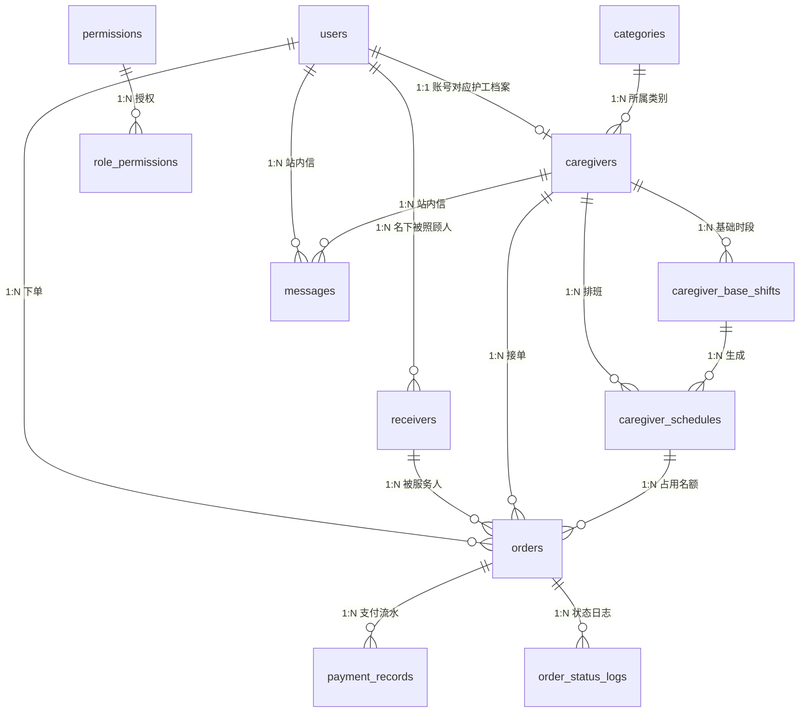

# 数据库说明

## 总览

| 表 | 说明 | 主要关系 |
| --- | --- | --- |
| `users` | 账号（用户 / 护工 / 管理员） | 被 `caregivers`、`receivers`、`orders`、`messages` 引用 |
| `categories` | 服务类别 | 被 `caregivers` 引用 |
| `caregivers` | 护工档案 | `user_id` → `users`，`category_id` → `categories` |
| `caregiver_base_shifts` | 护工基础时段模板 | `caregiver_id` → `caregivers` |
| `caregiver_schedules` | 具体日期排班与名额 | `caregiver_id` → `caregivers`，`shift_id` → `caregiver_base_shifts` |
| `receivers` | 被照顾人档案 | `user_id` → `users` |
| `orders` | 服务订单 | `user_id` / `receiver_id` / `caregiver_id` / `schedule_id` |
| `payment_records` | 支付流水（扩展） | `order_id` → `orders` |
| `order_status_logs` | 订单状态流转日志（扩展） | `order_id` → `orders` |
| `messages` | 站内消息 | `to_user_id` → `users` 或 `to_caregiver_id` → `caregivers`（互斥） |
| `permissions` | 权限定义 | — |
| `role_permissions` | 角色-权限关联 | `permission_id` → `permissions` |

DDL 见 [V1__schema.sql](../backend/src/main/resources/db/migration/V1__schema.sql)，种子数据见 [V2__seed.sql](../backend/src/main/resources/db/migration/V2__seed.sql)。

## ER 图



## 关键约束

- **名额**：`remaining_quota` 满足 `0 <= remaining_quota <= total_quota`，扣减通过
  `UPDATE ... SET remaining_quota = remaining_quota - 1 WHERE id = ? AND remaining_quota > 0` 原子完成
- **唯一性**：
  - `users.phone`、`orders.order_no`、`caregivers.code`、`categories.code/name`
  - `caregiver_schedules (caregiver_id, service_date, start_time)`：同一护工同一时段只能有一条排班
  - `receivers (user_id, id_card)`：同一用户不能重复添加同一人
- **消息收件人**：`messages` 通过 CHECK 约束保证 `to_user_id` 与 `to_caregiver_id` 有且只有一个非空（文档要求）
- **状态机**：订单状态由应用层 `OrderStatus` 控制，数据库 CHECK 仅做兜底

## 迁移

```bash
cd backend
./mvnw flyway:info      # 查看迁移状态（需配置 spring.flyway 的数据库连接）
./mvnw spring-boot:run  # 启动时自动执行未应用的迁移
```

规则：

1. 已发布的迁移脚本**不修改**，变更一律新增 `V{n}__xxx.sql`
2. 脚本必须同时兼容 MySQL 8 与 H2 2.x（MySQL 模式），不使用 `ENGINE=`、`ENUM`、生成列等方言
3. 种子数据只放字典与演示账号，业务数据由接口产生
